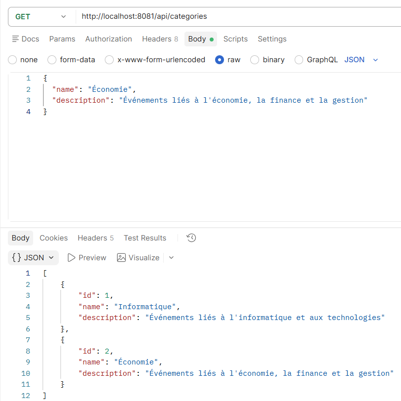
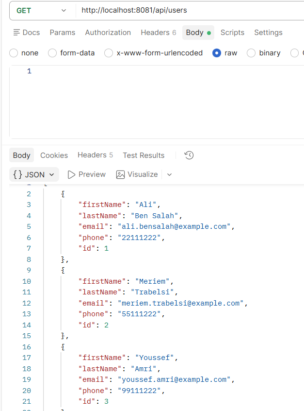
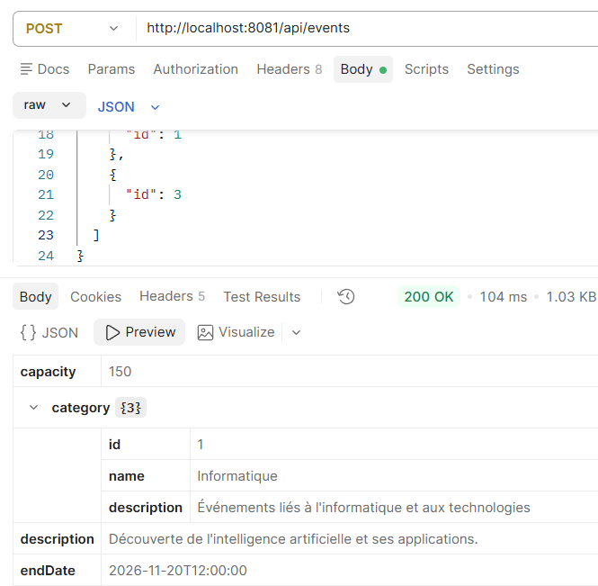
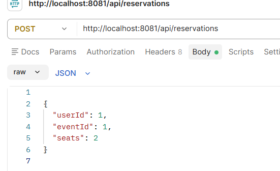

Screenshots - GestionReservation

 1. Gestion des catégories
Cette capture montre la récupération de la liste des catégories.

2. Gestion des utilisateurs
Cette capture montre la récupération de la liste des utilisateurs.

3. Gestion des événements
Cette capture montre la création d'un événement avec ses informations.

4. Gestion des réservations
Cette capture montre l'ajout d'une réservation pour un utilisateur.

